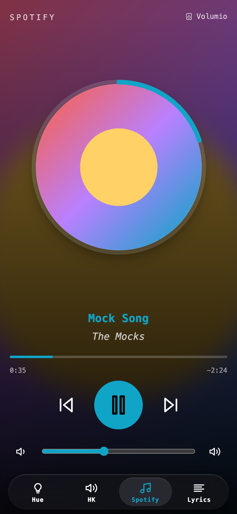
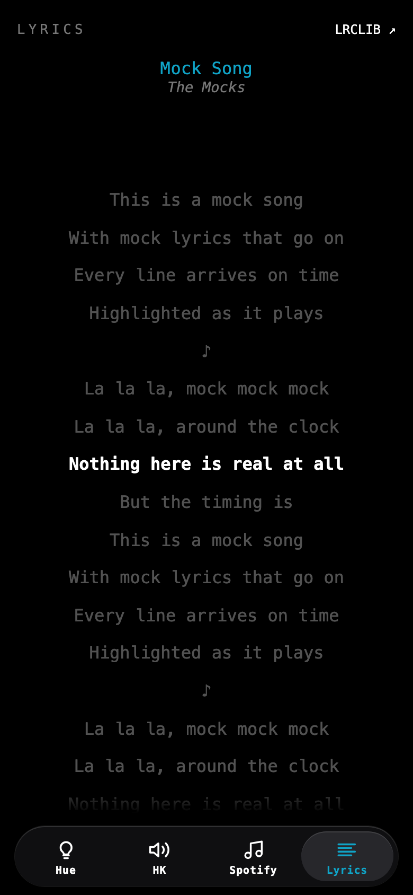
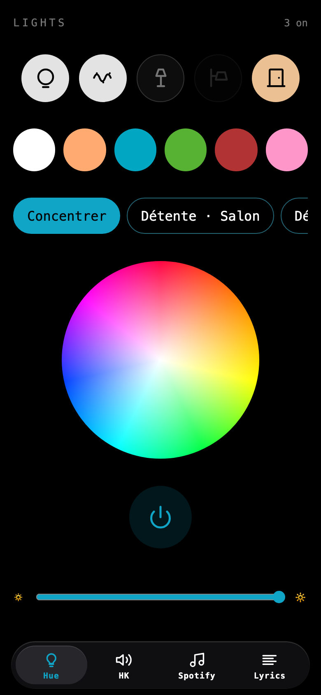
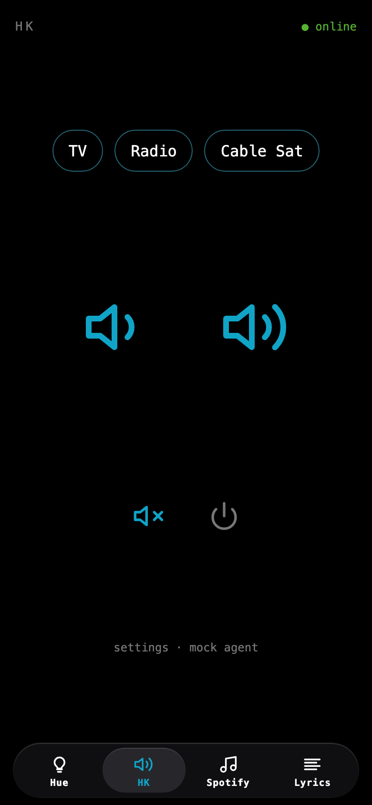

# 🔉 HK

A phone remote for the living room: Spotify, a Harman Kardon amplifier, Philips Hue lights, and the lyrics of the song
that plays. It is a web app you add to your iPhone home screen, plus a small agent that runs at home, for example on a
Raspberry Pi.

<table>
  <tr>
    <td></td>
    <td></td>
    <td></td>
    <td></td>
  </tr>
</table>

The screenshots come from the agent's mock mode, which fakes every device.

## What it does

- **Spotify**: the artwork turns into a disc with a progress ring, and a blurred copy fills the background. The app
  takes its accent colour from the artwork. Tap the disc to play or pause, tap twice to like the song. Beside the play
  controls, the radio button queues songs like the current one, and the list button opens your playlists, Liked Songs
  first. Pick the playing device from the header, set the volume at the bottom.
- **Lyrics**: the words of the current song. When [LRCLIB](https://lrclib.net) has them time-coded, the line being sung
  lights up and stays in the middle of the screen. They load as soon as the song changes, so they are ready when you
  open the tab.
- **Hue**: tap a lamp to switch it on or off, hold it to colour that lamp alone. The scenes saved in the Hue app, colour
  swatches, a colour wheel, a brightness slider and a big "all off" button.
- **HK**: the amp's inputs, volume, mute and power, with an online dot.

Swipe left or right to change tabs (arrow keys on a computer). Added to the iPhone home screen, it opens full screen like
a native app.

## How it works

```
phone ──HTTPS──▶ web app (static, for example https://hk.vumble.dev)
                      │
                      │ fetch + bearer token
                      ▼
            agent URL (Tailscale Funnel, or any HTTPS tunnel)
                      │
                      ▼
          agent/ (Node, at home) ──TCP 10025──▶ Harman Kardon amp
                                 ──HTTPS─────▶ Hue bridge
                                 ──HTTPS─────▶ Spotify, LRCLIB and Genius APIs
```

The amp only speaks a raw TCP protocol on the local network, and the Hue bridge only answers there too, so one small
process has to run at home. Everything else is a static web page.

The web app keeps the agent URL and its token in your browser and talks straight to your agent. A hosted copy runs at
https://hk.vumble.dev and you are welcome to use it: no server of mine sees your token or your requests. You can also
deploy your own copy (see [Development](#development)).

## What you need

- An always-on machine on your home network that runs Node 14.13 or newer. A Raspberry Pi is plenty: mine runs on the
  Pi of a [Volumio](https://volumio.com) music player.
- A Philips Hue bridge.
- A Harman Kardon amplifier that speaks the network protocol of the AVR 3700 (TCP port 10025). It is only tested with
  the AVR 3700; other Harman Kardon receivers of the same years may work.
- A way to give the agent an HTTPS URL, because the web app is served over HTTPS and browsers block calls from an
  HTTPS page to a plain `http://` address. [Tailscale Funnel](https://tailscale.com/kb/1223/funnel) is free and the
  install script can set it up.
- Optional: Spotify Premium and your own Spotify developer app, for the Spotify tab.
- Optional: a Genius API token, to find lyrics that LRCLIB does not have.
- Optional: a free Last.fm API key, for song radio.

## Setup

### 1. Configure the agent

```bash
git clone https://github.com/ValentinMumble/hk.git
cd hk/agent
cp .env.dist .env
```

Fill `agent/.env`. Every setting is explained in [`.env.dist`](agent/.env.dist). The required ones:

| Setting        | What                                                                                                                          |
| -------------- | ----------------------------------------------------------------------------------------------------------------------------- |
| `AGENT_TOKEN`  | The shared secret the app sends. It is the only protection, so make it long: `openssl rand -hex 24`                           |
| `HK_IP`        | The amp's IP address on your network                                                                                          |
| `HUE_URL`      | The bridge's address, `https://<ip>` (find the IP with `curl https://discovery.meethue.com/`)                                 |
| `HUE_USERNAME` | A key created on the bridge with the link-button pairing ([Hue guide](https://developers.meethue.com/develop/get-started-2/)) |

To try it on your computer first: `npm install && npm run build && npm start`.

### 2. Install it on a Raspberry Pi

From your computer, with SSH access to the Pi (`ssh-copy-id user@host` once):

```bash
agent/deploy/install-pi.sh volumio@volumio.local
```

It builds the agent on your computer, copies it with your `.env` to `~/hk-agent` on the Pi, and installs a systemd
service (`hk-agent`) that starts at boot and restarts after a crash. It asks for the Pi's sudo password once, then checks
that the agent answers. It is safe to run again after any change, and it is all you need after a fresh flash.

The script picks a Node for the Pi (`agent/deploy/pick-node.sh`): a private copy under `~/hk-agent/node` when an
official Node build runs on the Pi's system, otherwise the system Node. Older systems such as Raspbian Buster (Volumio 3)
cannot run Node 18 or newer, so there the agent runs on the system's Node 14.

On the Pi: `systemctl status hk-agent` and `journalctl -u hk-agent -f`.

On a Mac, `agent/deploy/dev.vumble.hk-agent.plist` is a launchd equivalent of the service (edit its paths first).

### 3. Give the agent an HTTPS URL

With [Tailscale Funnel](https://tailscale.com/kb/1223/funnel) you get a public HTTPS URL with a real certificate and no
port forwarding.

In one go: create a reusable auth key in the Tailscale admin console (Settings, then Keys), add it to `agent/.env` as
`TS_AUTHKEY`, and run the install script again. It installs Tailscale on the Pi, names the machine `TS_HOSTNAME`
(default `hk`) and opens the Funnel. The first time, Tailscale may ask you to enable Funnel for your tailnet. Your agent
URL is then `https://hk.<your-tailnet>.ts.net`.

By hand, on the Pi:

```bash
curl -fsSL https://tailscale.com/install.sh | sh
sudo tailscale up --hostname hk
sudo tailscale funnel --bg 8787
tailscale funnel status            # shows the public URL
```

After a reflash, remove the old machine in the Tailscale admin console before installing again, otherwise the new one
gets a `-1` suffix and the URL changes. Any other tunnel works too (Cloudflare Tunnel, ngrok): the app only needs a URL.

### 4. Open the app

Open https://hk.vumble.dev (or your own copy) and enter the agent URL and the token.

To set up a phone without typing, put the agent URL in `agent/.env` as `AGENT_URL` and run
`agent/deploy/phone-link.sh` on a Mac. It copies a setup link to the clipboard, which holds the URL and the token. Paste
it in Safari on the phone (Universal Clipboard works from the Mac), then use Share, Add to Home Screen.

The home-screen app keeps its own storage, separate from Safari. If it asks for the settings again, paste the same link
into its URL field: it fills both fields.

### 5. Connect Spotify (optional)

1. Create an app in the [Spotify developer dashboard](https://developer.spotify.com/dashboard). Add the web app's
   address as a redirect URI: `https://hk.vumble.dev/` (or your own copy's address), plus `http://127.0.0.1:5181/` for
   development.
2. Put its client ID and secret in `agent/.env` as `SPOTIFY_CLIENT_ID` and `SPOTIFY_CLIENT_SECRET`, then run the
   install script again.
3. Tap "Connect Spotify" in the app and approve.

The agent keeps one Spotify session for every phone and computer (in `spotify.json` next to `dist/` on the Pi) and
refreshes it by itself. That matters on iOS: the home-screen app cannot finish a login redirect, so you log in once from
any browser and every app just asks the agent. After a fresh flash of the Pi, connect again.

`SPOTIFY_DEFAULT_DEVICE` is the Spotify Connect device the agent wakes up when nothing is playing anywhere. Playback
control through the Spotify API needs Premium.

Song radio needs a Last.fm API key: Spotify stopped giving recommendations to apps in development mode in November 2024.
Create one for free at https://www.last.fm/api/account/create and put it in `agent/.env` as `LASTFM_API_KEY`. The agent
asks Last.fm for songs like the current one (or, for a little-known song, its similar artists), keeps at most two songs
per artist, finds them on Spotify and adds up to 20 of them to the queue, after the song that is playing.

### 6. Lyrics

The Lyrics tab works without any setup. Its words come from [LRCLIB](https://lrclib.net), an open lyrics database that
needs no key. Time-coded lines are only used when LRCLIB has them for a recording of the same length (within 3 seconds),
otherwise the plain words show.

For songs LRCLIB does not know, the agent can ask Genius too: create an API client at https://genius.com/api-clients and
put its client access token in `agent/.env` as `GENIUS_TOKEN`. Genius has no time-coded lines.

Lyrics only show when the source has a song with the same artist and title, so an unknown song shows nothing rather than
another song's words.

## Updating the agent

Every push to `main` that touches `agent/` runs `.github/workflows/agent-release.yml`: it tests and builds the agent and
publishes `agent-dist.tar.gz` as the GitHub release tagged `latest`. In the app, Settings (on the HK tab), then "fetch
latest build", makes the agent download that release, swap its `dist/` folder and restart. The previous build stays on
the Pi as `dist.previous`.

The agent updates from `GITHUB_REPO` (default `ValentinMumble/hk`). It runs whatever that repository releases, so point
it at a repository you trust, such as your own fork. A private repository also needs `GITHUB_TOKEN`, a fine-grained token
with read access to its contents.

## Development

```bash
npm install
npm run dev               # web app on http://127.0.0.1:5181
cd agent && npm run mock  # agent with fake devices on :8787, token "mock"
```

Then open `http://127.0.0.1:5181/#agent=http://localhost:8787&token=mock`. The dev server uses `127.0.0.1` rather than
`localhost` because Spotify only accepts that form as a local redirect address. It runs on plain HTTP, so it can also
talk to a real agent on your network directly.

Other commands: `npm run build` (type check and build into `dist/`), `npm run format`, and `npm test` in `agent/` (a fake
amp checks the TCP protocol, no hardware needed).

| Path     | What                                                                       |
| -------- | -------------------------------------------------------------------------- |
| `src/`   | The web app: Vite, React and TypeScript, no UI library                     |
| `agent/` | The home service: Node 14.13 or newer, TypeScript, no runtime dependencies |
| `mac/`   | The Mac menu bar remote: SwiftUI, no dependencies                          |

To deploy your own copy of the web app, import the repository in [Vercel](https://vercel.com) (framework preset Vite,
root directory `/`). There is no server and no environment variable to set; `.vercelignore` leaves `agent/` and `mac/`
out.

## Mac menu bar app

`mac/` holds a small native remote for the Mac menu bar: a click on the speaker icon opens a panel with the Spotify
controls and volume, the amp's volume, mute, power and inputs, and the Hue scenes with "All off". At the bottom, the
lyrics follow the song line by line when they are time-coded. It talks to the same agent and reads nothing in the
background: the playback is read when the panel opens (with the lyrics, for a new song), the amp inputs and Hue scenes
when the app starts, and the rest only on a click. Beside the icon, the menu bar also shows the download speed and, when a
charger is plugged in, its wattage, read from the Mac itself every 5 seconds.

Build and install it in `~/Applications` (needs Xcode or its command line tools, macOS 26 or newer for its Liquid Glass look):

```bash
mac/build.sh --open
```

On first launch it asks for the agent: paste the setup link from `agent/deploy/phone-link.sh`, or the URL and the token.
The URL is kept in the app's settings and the token in the login keychain. The gear button reopens these settings, with
"Open at login" and "Quit".

## Agent API

Every route needs `Authorization: Bearer <AGENT_TOKEN>`.

| Method | Path                      | Body                                              | Does                                                                                          |
| ------ | ------------------------- | ------------------------------------------------- | --------------------------------------------------------------------------------------------- |
| GET    | `/`                       |                                                   | Agent info: version, build, uptime, sources, what is configured                               |
| POST   | `/hk/<command>`           |                                                   | `on` `off` `sleep` `volume-up` `volume-down` `mute` `play` `pause` `next` `previous` `status` |
| POST   | `/hk/source`              | `{"source": "TV"}`                                | Select an input                                                                               |
| GET    | `/hue/lights`             |                                                   | Every light with its state and colour                                                         |
| POST   | `/hue/all`                | `{"on"?, "color"?: "#hex", "brightness"?: 0-100}` | Every light at once; also `effect`, `alert` and `transition` (seconds)                        |
| POST   | `/hue/lights/<id>`        | same                                              | One light                                                                                     |
| POST   | `/hue/lights/<id>/toggle` |                                                   | Flip one light, returns `{on}`                                                                |
| GET    | `/hue/scenes`             |                                                   | The scenes saved on the bridge, with their room                                               |
| POST   | `/hue/scenes/<id>`        |                                                   | Recall a scene                                                                                |
| GET    | `/lyrics`                 |                                                   | Lyrics of the current song, or of `?artist=&title=`                                           |
| POST   | `/update`                 |                                                   | Install the latest release and restart                                                        |

Spotify: `GET /spotify/state`, `devices`, `playlists`, `queue`, `search?q=`, `auth-url?redirect=&state=`;
`POST /spotify/play {uri?|contextUri?}`, `pause`, `next`, `previous`, `seek {positionMs}`, `volume {percent}`,
`shuffle {state}`, `repeat {state}`, `transfer {deviceId, play}`, `like {trackId, saved}`, `queue {uri}`,
`radio {trackId}`,
`authorize {code, redirectUri}`, `logout`.

## Notes

- **Hue**: recent bridge firmware only answers over HTTPS with a self-signed certificate, which the agent accepts. For
  an old bridge set `HUE_URL=http://<ip>`. Colours go to the bridge as CIE xy values; lights without colour only get
  on, off and brightness.
- **Amp**: it closes its network API after a while in standby, and `on` only works when network standby is enabled on
  the amp. `status` is the only command the amp answers, and the app uses it for the online dot.
- **Amp inputs**: `HK_SOURCES` lists the inputs shown as buttons, named as the amp names them: `Radio`, `TV`,
  `Cable Sat`, `Disc`, `Game`, `Aux`, `Network`, ...

## License

[MIT](LICENSE), except the app icon: it is Apple's speaker emoji, which this license does not cover.
